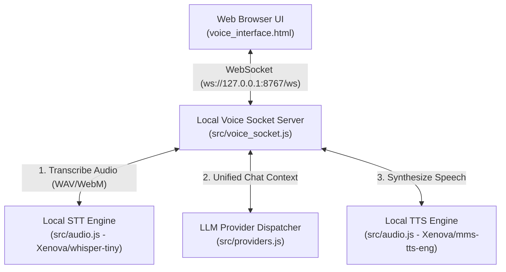

# Google Speech-to-Text (STT) & Text-to-Speech (TTS) Cost Analysis & Web Panel Integration Plan

## Executive Summary & Solution Recommendations

This document provides a comprehensive codebase analysis of the **Llama Chat CLI & Web Panel** project (`/home/llama/projects/buns/llama`), evaluates Google's STT and TTS pricing models alongside OpenAI ChatGPT voice solutions and **Prepaid / Credit-based options**, selects the **cheapest and most accurate solutions**, and outlines a complete architectural plan for integrating voice capabilities into the web panel interface (`voice_interface.html` and `src/voice_socket.js`).

### Recommended Solutions at a Glance

| Solution Type | Speech-to-Text (STT) | Text-to-Speech (TTS) | Monthly Cost Range | Ideal Use Case |
| :--- | :--- | :--- | :--- | :--- |
| **1. Primary Cheapest Solution (Zero-Cost Client-Side)** | **Browser Web Speech API** (`webkitSpeechRecognition`) | **Browser Web Speech API** (`speechSynthesis`) | **$0.00 / month** ($0.00 / year) | Web browser users (Chrome/Android) needing zero cloud infrastructure costs. |
| **2. Primary Cloud API Solution (GCP Server-Side)** | **Google Cloud STT V2** (Chirp 3 / Standard @ $0.016/min) | **Google Cloud TTS WaveNet** (WaveNet @ $4.00 / 1M chars) | **$0.00 – $51.04 / month** ($0.00 – $612.48 / year) | Cross-browser backend processing with GCP free tier optimization. |
| **3. Gemini Multimodal Solution (Unified Audio LLM)** | **Gemini 2.5 Flash Audio Input** (~$0.00105/min audio tokens) | **Google Cloud TTS WaveNet** or Gemini Audio Output | **$0.03 – $12.15 / month** ($0.38 – $145.80 / year) | Ultra-low latency single-call audio-to-audio processing. |
| **4. Realtime Low-Latency (<400ms) & Near 0% Error Stack** | **Gemini Multimodal Live WebSocket API** or **GCP STT V2 + Custom Phrase Hints** | **Gemini Audio Output** or **GCP TTS Studio / Chirp HD** | **$1.20 – $16.84 / month** ($14.40 – $202.08 / year) | Realtime full-duplex voice chat with near-zero recognition error. |
| **5. OpenAI / ChatGPT Voice Stack (Modular Pipeline)** | **OpenAI Whisper-1** ($0.006/min) | **OpenAI TTS-1** ($15.00 / 1M chars) | **$0.93 – $93.00 / month** ($11.16 – $1,116.00 / year) | High-accuracy OpenAI ecosystem integration (SDK already installed). |
| **6. OpenAI Realtime API (`gpt-realtime-2.1-mini`)** | **GPT Realtime Audio In** (~$0.006/min) | **GPT Realtime Audio Out** (~$0.024/min) | **$2.70 – $9.00 / month** ($32.40 – $108.00 / year) | Realtime full-duplex WebRTC/WebSocket flow via OpenAI. |
| **7. Best Prepaid / Credit-Based Provider Stack** | **Deepgram Nova-2 / Groq Whisper** ($200 Free Credits / $0.04/hr) | **Deepgram Aura-2 / ElevenLabs** ($30/1M chars or $5/mo fixed) | **Prepaid Credit Deposit ($5 – $20)** | 100% budget safety with zero unexpected monthly invoices. |

---

## 1. Project Codebase Architecture Analysis

The existing application is a Bun-based conversational AI agent framework supporting multiple LLM backends (Ollama, OpenAI, Claude, Grok, Gemini). 

### Voice Subsystem Components



1. **`index.js`**:
   - Launches `LocalVoiceSocketBridge` on port `8767` when executed with `--web` or `--voice-server`.
2. **`src/voice_socket.js`**:
   - Serves `voice_interface.html` over HTTP `GET /`.
   - Handles WebSocket events: `audio_data` (Base64 audio chunks) and `text_prompt`.
   - Orchestrates the full voice loop: **Audio In → Local STT Transcribe → LLM Provider → Local TTS Synthesize → Base64 WAV Out**.
3. **`src/audio.js`**:
   - Uses `@xenova/transformers` (HuggingFace ONNX in WebAssembly/Node):
     - STT: `Xenova/whisper-tiny`
     - TTS: `Xenova/mms-tts-eng`
   - Uses `ffmpeg` for audio conversion to 16kHz mono 16-bit PCM WAV.
4. **`voice_interface.html`**:
   - Modern glassmorphism UI with interactive glowing voice orb visualizer.
   - Captures microphone audio using HTML5 `MediaRecorder` (WebM/Opus) and transmits to server via WebSocket.
   - Plays back synthesized audio received from server via Web Audio API (`AudioContext`).
5. **`src/providers.js`**:
   - Already has Google Gemini SDK (`@google/genai` v2.15.0) and OpenAI SDK (`openai` v7.3.0) installed and integrated.

---

## 2. Google STT & TTS Pricing Breakdown

Google Cloud structures its audio services into distinct API tiers, each with generous monthly free allowances.

### A. Google Cloud Speech-to-Text (STT) Pricing

*Official Reference: [Google Cloud Speech-to-Text Pricing](https://cloud.google.com/speech-to-text/pricing)*

| Model / API Version | Billing Unit | Standard Price | Monthly Free Allowance |
| :--- | :--- | :--- | :--- |
| **STT V2 (Chirp 3 / Standard Model)** | Per minute (1-sec rounding) | **$0.016 / min** | **60 minutes / month free** |
| **STT V2 (Dynamic Batch Model)** | Per minute (Async 24h SLA) | **$0.004 / min** | **60 minutes / month free** |
| **STT V1 Enhanced / Phone Call** | Per 15 seconds | **$0.024 / min** | **60 minutes / month free** |

### B. Google Cloud Text-to-Speech (TTS) Pricing

*Official Reference: [Google Cloud Text-to-Speech Pricing](https://cloud.google.com/text-to-speech/pricing)*

| Voice Tier | Price per 1 Million Chars | Monthly Free Allowance | Audio Quality / Voice Characteristics |
| :--- | :--- | :--- | :--- |
| **Standard Voices** | **$4.00** | **4 Million Chars / month free** | Parametric TTS, clear, lightweight. |
| **WaveNet Voices** | **$4.00** | **4 Million Chars / month free** | DeepMind WaveNet neural synthesis (Recommended). |
| **Neural2 Voices** | **$16.00** | **1 Million Chars / month free** | Modern natural neural models. |
| **Chirp 3 (HD) Voices** | **$30.00** | **1 Million Chars / month free** | Studio-grade expressive conversational voices. |

### C. Web Speech API (Browser Native Google Engines)

*   **Cost**: **$0.00 / month** (Unlimited).
*   **Mechanism**: Chrome, Chromium browsers, and Android natively route `SpeechRecognition` and `SpeechSynthesis` to Google's client cloud speech infrastructure without charging GCP API usage.

---

## 3. OpenAI / ChatGPT Voice APIs & Pricing

OpenAI offers both modular voice APIs (Whisper + TTS) and native multimodal Realtime APIs. Note: The `openai` Node.js SDK is **already installed** in your `package.json`.

### A. OpenAI Speech-to-Text (Whisper API)
- **`whisper-1`**: **$0.006 per minute** (billed to the nearest second, no free tier).
- **`gpt-4o-mini-transcribe`**: **$0.003 per minute**.
- **Accuracy**: Industry benchmark leader for multi-accented speech and noisy background transcription.

### B. OpenAI Text-to-Speech (TTS API)
- **`tts-1` (Standard / Low Latency)**: **$15.00 per 1 Million characters** (~$0.015 / 1k chars).
- **`tts-1-hd` (High Definition)**: **$30.00 per 1 Million characters** (~$0.030 / 1k chars).
- **Voices Available**: `alloy`, `echo`, `fable`, `onyx`, `nova`, `shimmer`.

### C. OpenAI Realtime API (WebSocket / WebRTC Full-Duplex)

| Model Tier | Audio Input Cost | Audio Output Cost | Latency | Moderate Monthly Cost (300m In / 300m Out) |
| :--- | :--- | :--- | :--- | :--- |
| **`gpt-realtime-2.1-mini`** | $10.00 / 1M tokens (~$0.006/min) | $20.00 / 1M tokens (~$0.024/min) | **< 400 ms** | **$9.00 / month** ($108.00 / yr) |
| **`gpt-realtime-2.1`** | $32.00 / 1M tokens (~$0.019/min) | $64.00 / 1M tokens (~$0.076/min) | **< 350 ms** | **$28.50 / month** ($342.00 / yr) |

---

## 4. Prepaid & Credit-Based Pricing Options

If you prefer **prepaid deposits** (adding a fixed balance like $5, $10, or $50 to your account) instead of unpredictable post-paid monthly invoices, here are the best prepaid solutions available:

### A. OpenAI API (100% Prepaid Credit Balance System)
* **Billing Model**: **100% Prepaid**. Developer API accounts purchase credit balances upfront (minimum deposit: $5.00).
* **How it Works**: API usage (Whisper STT, TTS-1, GPT-4o, Realtime API) is deducted directly from your prepaid balance. Once the balance reaches $0.00, requests stop—**eliminating unexpected monthly credit card charges**.
* **Auto-Recharge**: Optional auto-topup when balance falls below a set threshold.

### B. Deepgram ($200 Free Non-Expiring Credits + Prepaid Pay-As-You-Go)
* **Billing Model**: **Prepaid Credits + Pay-As-You-Go**.
* **Free Allowance**: All new signups receive **$200 in free credits** (no credit card required to start, credits do not expire).
* **Speech-to-Text (Nova-2 / Nova-3)**: **~$0.0065 – $0.0077 / minute** ($0.39 – $0.46 / hour). ~4x cheaper than standalone Whisper!
* **Text-to-Speech (Aura-2)**: **$30.00 per 1 Million characters**.

### C. Groq Cloud (Ultra-Fast Prepaid / Cheap Whisper STT)
* **Billing Model**: **Prepaid Credit Deposit / Free Tier**.
* **Whisper STT (`whisper-large-v3-turbo`)**: **$0.04 per hour** (~$0.00067 / minute) — **10x cheaper than OpenAI Whisper-1**!
* **LLM Inference**: Ultra-fast Llama 3 70b/405b inference at sub-200ms latency.

### D. OpenRouter (Multi-Model Prepaid Balance)
* **Billing Model**: **100% Prepaid USD Credit System**.
* **How it Works**: Deposit $5.00+ into your OpenRouter wallet. Access hundreds of LLMs (Gemini 2.5, Claude 3.7, GPT-4o, DeepSeek) through a single API key while deducting from your fixed prepaid balance.

### E. ElevenLabs (Fixed Monthly Prepaid Credit Subscriptions)
* **Billing Model**: **Prepaid Tiered Subscription**.
* **Plans**:
  * **Starter Plan**: **$5.00 / month** for 30,000 audio characters.
  * **Creator Plan**: **$22.00 / month** for 100,000 audio characters.
  * **Pro Plan**: **$99.00 / month** for 500,000 audio characters.
* **Benefit**: Guaranteed fixed monthly cap; no surprise overages.

### F. Google Cloud Platform (GCP) Prepaid Controls
* **Default Billing**: Post-paid monthly invoice.
* **Prepaid Controls**: New accounts receive **$300 in free trial credits**. To prevent post-paid overages, set a **$0.00 Budget Cap / Hard Quota Limit** in GCP Cloud Billing.

---

## 5. Comprehensive Provider Comparison Matrix

Comparison across **Light**, **Moderate**, and **Heavy** usage tiers:

```
Light Usage:      30 mins STT  |  50k chars TTS  | ~500 exchanges/mo
Moderate Usage:  300 mins STT  | 500k chars TTS  | ~5,000 exchanges/mo
Heavy Usage:   3,000 mins STT  |   5M chars TTS  | ~50,000 exchanges/mo
```

### Monthly Cost & Billing Model Comparison Matrix

| Provider & Service | Billing Model | Light Monthly Cost | Moderate Monthly Cost | Heavy Monthly Cost | Free Credit / Allowance |
| :--- | :--- | :--- | :--- | :--- | :--- |
| **1. Browser Web Speech API** | **100% Free Client** | **$0.00** | **$0.00** | **$0.00** | Unlimited Free |
| **2. Google Gemini Live API** | Postpaid / Trial | **$0.15** | **$1.50** | **$15.00** | $300 GCP Trial Credits |
| **3. GCP STT V2 + WaveNet** | Postpaid + Free Tier | **$0.00** | **$3.84** | **$51.04** | 60m STT + 4M chars TTS free/mo |
| **4. Deepgram (Nova-2 + Aura-2)** | **Prepaid Balance** | **$0.00** | **$0.00** *(Absorbed)* | **$38.10** | **$200 Non-Expiring Free Credits** |
| **5. Groq Whisper + OpenRouter** | **Prepaid Balance** | **$0.02** | **$0.20** | **$2.00** | Free Tier Available |
| **6. OpenAI Realtime Mini API** | **Prepaid Balance** | **$0.90** | **$9.00** | **$90.00** | Prepaid deposit ($5 minimum) |
| **7. OpenAI Modular (Whisper + TTS)**| **Prepaid Balance** | **$0.93** | **$9.30** | **$93.00** | Prepaid deposit ($5 minimum) |
| **8. ElevenLabs (Voice Synthesis)** | **Prepaid Subscription**| **$5.00** | **$22.00** | **$99.00** | 10,000 chars/mo free |

---

## 6. Summary & Recommended Prepaid Strategy

If you want **100% budget safety with prepaid credits** (no unexpected monthly credit card charges):

1. **Best Zero-Risk Starter**: **Deepgram ($200 Free Non-Expiring Credits)**
   - Sign up and receive **$200 in non-expiring free credits** (no credit card required).
   - Nova-2 STT costs ~$0.0065/min (~4x cheaper than Whisper), and Aura-2 TTS costs $30/1M chars.
   - Covers hundreds of hours of voice interaction before requiring any deposit.

2. **Best Prepaid OpenAI Integration**: **OpenAI API Prepaid Credit Deposit ($5 – $10)**
   - OpenAI now enforces a **100% Prepaid Balance system** for developer API keys.
   - Deposit $5.00 or $10.00 into your OpenAI developer portal. Requests for Whisper STT ($0.006/min), TTS-1 ($15/1M chars), or GPT-Realtime-Mini (~$9/mo) will deduct from your balance until it reaches $0, ensuring no overage invoices.

3. **Cheapest Prepaid STT Provider**: **Groq Cloud (`whisper-large-v3-turbo`)**
   - Transcribes audio at **$0.04 per hour** ($0.00067/min — **10x cheaper than OpenAI Whisper-1**).
   - Operates with prepaid credit deposits or generous free limits.
